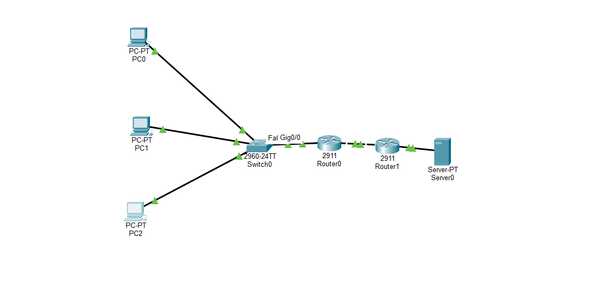
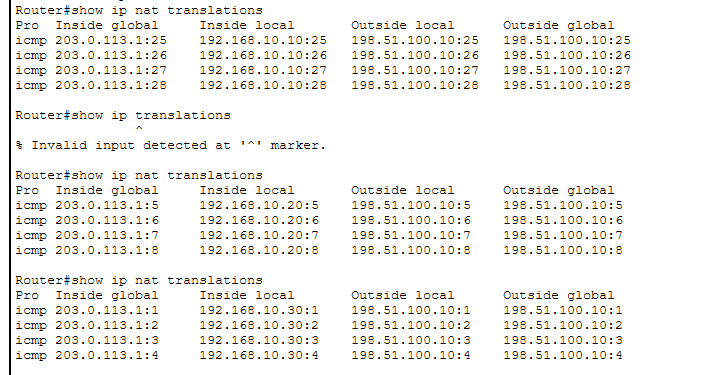
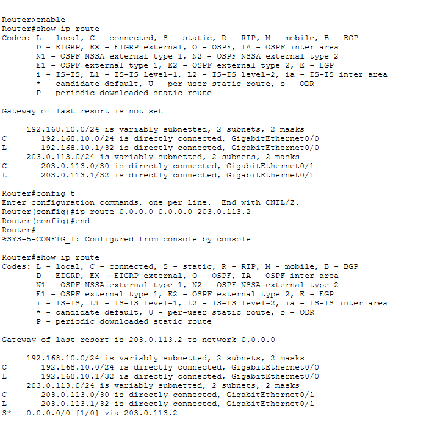
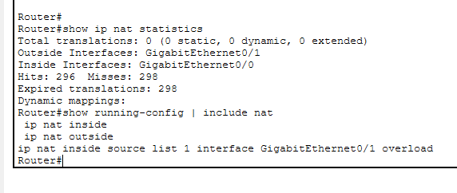

# Lab 6 — NAT & PAT Overload

## Lab Overview

This lab demonstrates the configuration and verification of Network Address Translation (NAT) and Port Address Translation (PAT) using Cisco routers in Packet Tracer.

The objective was to enable three devices on a private LAN to communicate with an external server while sharing a single outside IP address.

The lab also included troubleshooting a routing issue that initially prevented successful communication.

## Network Topology

The network consists of:

- 3 PCs representing internal clients
- 1 Cisco 2960 switch
- 2 Cisco 2911 routers
- 1 external server

**Traffic flow:**

PC0 / PC1 / PC2 → Switch0 → Router0 (NAT/PAT) → Router1 (ISP Simulation) → Server0

## IP Addressing

| Device | Interface | IP Address | Default Gateway |
|---|---|---|---|
| PC0 | Fa0 | 192.168.10.10/24 | 192.168.10.1 |
| PC1 | Fa0 | 192.168.10.20/24 | 192.168.10.1 |
| PC2 | Fa0 | 192.168.10.30/24 | 192.168.10.1 |
| Router0 | G0/0 | 192.168.10.1/24 | N/A |
| Router0 | G0/1 | 203.0.113.1/30 | N/A |
| Router1 | G0/1 | 203.0.113.2/30 | N/A |
| Router1 | G0/0 | 198.51.100.1/24 | N/A |
| Server0 | Fa0 | 198.51.100.10/24 | 198.51.100.1 |

The external IP address ranges are documentation addresses used to simulate public networks.

## NAT/PAT Configuration

Router0 was configured to translate private addresses from the 192.168.10.0/24 network to its outside interface address.

```cisco
access-list 1 permit 192.168.10.0 0.0.0.255

interface GigabitEthernet0/0
 ip nat inside

interface GigabitEthernet0/1
 ip nat outside

ip nat inside source list 1 interface GigabitEthernet0/1 overload
```

The `overload` keyword enables PAT, allowing multiple internal devices to share one outside IP address using unique port numbers or ICMP identifiers.

## Default Route Configuration

Router0 required a default route to forward traffic toward the simulated ISP router.

```cisco
ip route 0.0.0.0 0.0.0.0 203.0.113.2
```

The default route was verified using:

```cisco
show ip route
```

## Connectivity Testing

Connectivity was tested by pinging Server0 from all three internal PCs.

```text
ping 198.51.100.10
```

**Results:**

- PC0 — Successful
- PC1 — Successful
- PC2 — Successful

All three PCs successfully communicated with the external server after the routing and NAT/PAT configurations were completed.

## NAT Translation Verification

The following commands were used:

```cisco
show ip nat translations
show ip nat statistics
```

The translation table confirmed that the following private IP addresses shared the same inside global address:

| Inside Local | Inside Global |
|---|---|
| 192.168.10.10 | 203.0.113.1 |
| 192.168.10.20 | 203.0.113.1 |
| 192.168.10.30 | 203.0.113.1 |

ICMP identifiers distinguished the translation entries, enabling Router0 to return responses to the appropriate internal device.

## Troubleshooting Scenario — Missing Default Route

**Problem:** PC0 initially could not communicate with Server0.

The ping returned:

```text
Reply from 192.168.10.1: Destination host unreachable.
```

**Investigation:**

The Router0 routing table was examined using:

```cisco
show ip route
```

The output showed:

```text
Gateway of last resort is not set
```

**Root cause:**

Router0 did not have a default route toward Router1, preventing it from forwarding traffic to the external server network.

**Resolution:**

Configured the missing default route:

```cisco
ip route 0.0.0.0 0.0.0.0 203.0.113.2
```

**Verification:**

PC0 successfully pinged Server0 after the route was added.

Additional testing confirmed successful connectivity from PC1 and PC2 and verified the PAT translations.

## Key Lessons Learned

1. NAT translates IP addresses, but routing is still required to reach external networks.
2. PAT allows multiple private devices to share one outside IP address.
3. The NAT translation table identifies inside local and inside global addresses.
4. Cisco IOS `show` commands are essential for verification and troubleshooting.
5. ICMP error messages can help identify which router is reporting a connectivity problem.
6. A missing default route can prevent external connectivity even when NAT is configured correctly.

## Tools and Technologies

- Cisco Packet Tracer
- Cisco IOS
- IPv4 addressing and subnetting
- Static default routing
- NAT and PAT
- ICMP
- Network troubleshooting

## Lab Outcome

Successfully configured and verified NAT overload across three internal devices, diagnosed a missing default route, restored external connectivity, and validated the resulting translations using Cisco IOS commands.
## Lab Evidence

### Network Topology


### NAT/PAT Translation Verification

Verified that PC0, PC1, and PC2 successfully shared
the same outside IP address (203.0.113.1) using PAT.

  

### Default Route Troubleshooting and Verification

Identified a missing default route on Router0 that prevented
traffic from reaching the external server.

Configured a static default route pointing to Router1
(203.0.113.2) and verified the routing table.

  

### NAT/PAT Configuration Verification

Verified that Router0 uses G0/0 as the inside interface
and G0/1 as the outside interface.

PAT overload allows multiple private devices to share
the outside IP address 203.0.113.1.


